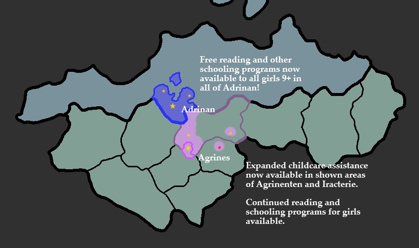

## National Statue: - Expansion of Reading and Additional schooling programs to Adrinan
It is the pleasure of the Duchess Agrinoa to announce the full expansion of the Women's Coalition local reading classes for girls age 9+ to the entire Duchy of Adrinan for free at the newly opened Queen Valerie college in Adrinan City! Additionally local reading classes will be held throughout the towns and villages of Adrinan, however additional educational subjects will remain exclusive to the Queen Valerie college for the time being.
Funding for this was provided directly by the voters in the first parliamentary election who's spillover campaign funds were used, with their knowledge, to support the fund for Women's Education Nationally. We at the National Statute congratulate the Duchess and lady Tala for this expansion of our liberation, continued work on larger expansions continues to be discussed.

Some critics against Anzarian integration such as the despicable rotten <@794675642037567498> and his socialist cabal have shown their opposition to this, this shows their true leanings, that be that they are AGAINST the global liberation of women and FOR the continued thousand year oppression of our voices!!

