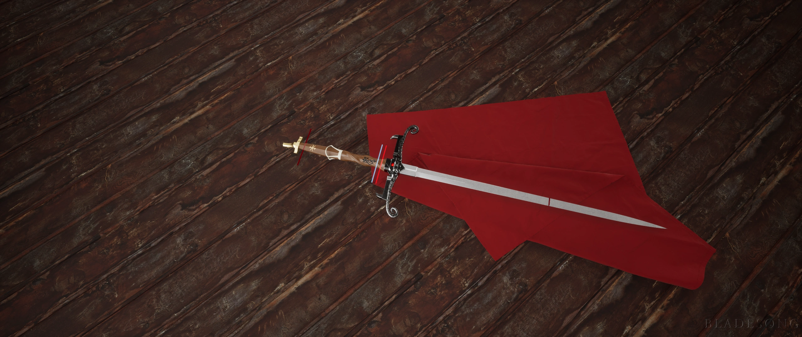

Today we bring history Imprekas Aemperas
***It was commissioned by the first queen of Aurelian line, the sword was forged for twenty years to be perfect and followed strict instructions on the engravings the engraving being in runic and of the two families one crushed obsidian and the other of gold, they where given a gem that was near the queens heart, which was added to the centre of the hilt believed to bring protection on to the imperial line,***
***The guard was forged in some of the most gruelling fires  and burned with extreme precision so that the colours would be pure black and so that the fires doesn't touch the silver, 
***The handle was made from the wood from a tree that only grows in a small area and only a hundred and forty nine exists after one was chopped done to be used for the handle which had to be grinded down by a specialized technique and only using sand paper, the connection point that joints the two handles was made of pure ivory.***

The palm was made in memory of the queen, their patron and so the gold they used was from the most expensive region and it was the purest gold that can be used. 
The blade is self was made to be the sharpest blade money could make and can cut through bone easily and it moves very fast, it was made to be used with one hand or two depending on what the user wants. It was only tasted blood in defence of the imperial bloodline, the whish blacksmiths whish was it to be used for protection and to be used a symbol of power but many say it is a sign that throne was meant for a woman as it was commissioned by the first  queen of the empire. the name is Imprekas Aemperas named after the queen in the blacksmith's language. Long live the crown under the protection of the Imprekas Aempera

Imprekas Aemperas. This bit will return and we will report more unbiased history also please ignore this, the original aurthor resigned and we will try our best to be unbiased but it will be best to go trhough other newspapers

