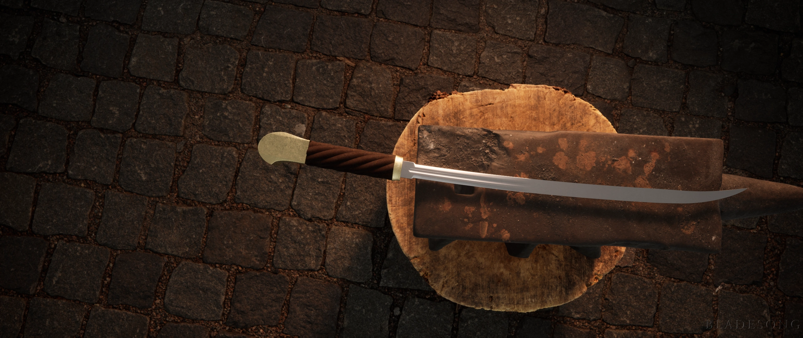

On today's histroy bit, the Erenaot, the blade of the Znamenny family, thank you to Bores Znamenny for allowing this to happen
The blade was a gift to Bores' great great grandfather from a general as his family help fund the defensive war. The materials used where bronze since gold was seen as a sensless use of fragile materials as gold at that time wasn't as refined as today so instead they used brass which was more expensive at time then today. It was made to protect orginally the family but wasn't always used that way, many of the family memebers used the blade to kill the common folk and then got away with it becasue the familial wealth. The weapon is able toe easily cut into bone and Bores has shown us that it's easily to maneuver and very fast. When it impales something it's hard to for that item to pull itself out but not the user of the blade to pull the blade out as it has a thick part meant to block the impaled from moving in deeper then needed, the curve at the tip allows for the weapon to pierce over small shields like bucklers but not any bigger. The curve brings extra weight that allows for the sword to cut through bone if the user is strong enough, it was only truly used in duels which where mostly unfair against the opponent not because of the sword but because of the family's connection making every duel their win even if they lost. This is why Bores mother and father left with their kids as the rest of the family was becoming too corrupt. The hook at the end is meant to catch the user's hand if it slips from the wood. The wood handle was made from a common type of wood that was wrapped several times over so that it's strong enough to resist cuts. The weapon was named after the great great grandfather, the blade know represents the common folk and a new path. The design is also now currently used by Bores' original home nation by officer though this weapon was the first of it's kind and the best

